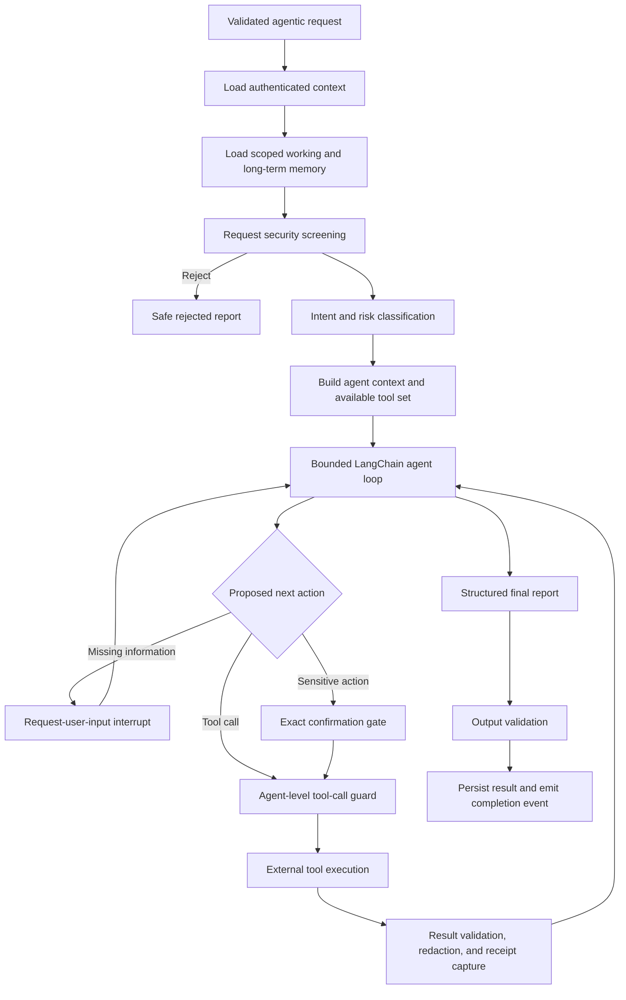

# Main Financial Agent Implementation Plan

## 1. Purpose and Scope

Build a non-user-facing financial agent using LangChain and LangGraph. The agent receives a natural-language request from the interaction layer, determines the user's intent, selects and invokes the available tools, pauses when it needs clarification or confirmation, resumes safely when the interaction layer returns the answer, and returns a short report describing what it did.

The agent is expected to support the complete set of financial capabilities exposed by the tool layer, including money transfers, bill payments, beneficiary management, investment purchases and sales, portfolio operations, account information, and other financial actions. The agentic layer owns orchestration, security enforcement around tool calls, task persistence, memory, and reporting. Other teammates own the underlying tool implementations.

The primary design goals are:

- Correctly complete financial requests using the available tools.
- Prevent unauthorized access to another user's information or resources.
- Resist direct and indirect prompt injection.
- Require secure, exact confirmation for sensitive financial actions.
- Never claim that a financial action succeeded without an authoritative tool result.
- Preserve enough state to pause, resume, retry, and audit tasks safely.
- Keep all model providers, limits, and operational policies easy to change through configuration.
- Provide a comprehensive automated test and evaluation suite.

### Implementation status

The agentic layer described here is implemented in this repository. It includes the deterministic
LangGraph orchestration, bounded LangChain agent, provider-neutral model factory, encrypted
PostgreSQL persistence, curated memory, guarded tool boundary, clarification and exact-confirmation
interrupts, signed API integration, structured reports, telemetry, retention tooling, migrations,
and automated release gates. Financial tool implementations remain owned by the tool-layer team and
are loaded through the configured provider interface; deterministic representative tools cover the
agent contract and financial workflows in this repository's tests.

## 2. Boundaries and Responsibilities

### Interaction layer

The interaction layer:

- Authenticates and communicates with the user.
- Sends a natural-language task plus authenticated metadata to the agentic layer.
- Presents clarification and confirmation questions to the user.
- Returns the user's answer to the paused agentic task.
- Presents the agent's final short report naturally in the user's language.

### Agentic layer

The agentic layer:

- Validates the incoming request and authenticated context.
- Classifies intent and risk.
- Loads safely scoped memory.
- Decides which available tool to call.
- Enforces agent-level authorization, isolation, confirmation, and execution limits.
- Treats tool results as untrusted data.
- Tracks tool calls and authoritative receipts.
- Persists and resumes long-running tasks.
- Returns a small structured report.

### Tool layer

The tool layer:

- Implements financial operations and data access.
- Enforces its own business rules and domain validation.
- Returns structured success, error, and receipt information.
- Remains outside the implementation scope of this plan.

The agentic layer will not modify the teammates' tools. Tools will be injected into the agent through a stable interface and wrapped at the agent boundary for security, auditing, and result validation.

## 3. Recommended Technology

- Python 3.12.
- LangChain 1.x `create_agent` for the bounded tool-using agent loop.
- LangGraph 1.x for deterministic orchestration, checkpointing, interrupts, and resumption.
- Pydantic v2 for strict schemas at every system boundary.
- FastAPI for the agentic service API.
- PostgreSQL as the production system of record.
- `langgraph-checkpoint-postgres` for task checkpoints.
- LangGraph `PostgresStore` for curated cross-task memory.
- `pgvector` for approved semantic memory after the structured-memory implementation is stable.
- SQLAlchemy and Alembic for application-owned tables and migrations.
- `psycopg` for LangGraph PostgreSQL integrations.
- LangSmith optionally for tracing and evaluation, while retaining a provider-neutral local evaluation runner.

Exact dependency versions must be pinned after an initial compatibility spike and upgraded only through tested dependency updates.

## 4. Architecture

The system must not be implemented as one unrestricted agent loop. A deterministic outer LangGraph controls identity, policy, memory, clarification, confirmation, tool execution, and final-output validation. A bounded LangChain agent inside the graph reasons about the request and proposes tool calls.



The model may propose actions, but deterministic code makes all security-sensitive decisions. The model must never control:

- User or tenant identity.
- Authorization scopes.
- Confirmation validity.
- Database namespaces.
- Account ownership.
- Execution budgets.
- Memory sensitivity rules.
- Audit logging.
- Whether a tool result is safe to expose.
- Whether a financial action is considered completed.

## 5. Proposed Project Structure

```text
main.py
agentic/
  __init__.py
  api/
    app.py
    routes.py
    dependencies.py
    schemas.py
  agent/
    builder.py
    graph.py
    state.py
    prompts.py
    routing.py
    report.py
  config/
    llm.yaml
    agent.yaml
    limits.yaml
    policies.yaml
    tools.yaml
    settings.py
    loader.py
  llm/
    factory.py
    capabilities.py
    errors.py
  policy/
    engine.py
    models.py
    request_policy.py
    financial_policy.py
    output_policy.py
    injection_signals.py
  middleware/
    request_guard.py
    model_guard.py
    tool_guard.py
    result_guard.py
    limits.py
    pii.py
    audit.py
  tools/
    registry.py
    metadata.py
    adapters.py
    clarification.py
    errors.py
  memory/
    service.py
    working.py
    long_term.py
    extraction.py
    retrieval.py
    policy.py
  persistence/
    database.py
    checkpointer.py
    store.py
    repositories/
      tasks.py
      events.py
      clarifications.py
      authorizations.py
      executions.py
      memories.py
  security/
    identity.py
    authorization.py
    confirmation.py
    signing.py
    redaction.py
    secrets.py
  telemetry/
    tracing.py
    logging.py
    metrics.py
  migrations/
  evals/
    datasets/
    graders/
    runners/
    reports/
tests/
  unit/
  contract/
  integration/
  end_to_end/
  security/
  memory/
  reliability/
```

`main.py` should only load configuration, construct dependencies, and expose the FastAPI application.

## 6. Provider-Independent LLM Configuration

Model construction must be separated from agent and graph code. The code will request a model by role rather than importing a provider-specific model directly.

Example `agentic/config/llm.yaml`:

```yaml
models:
  primary:
    provider: openrouter
    model: anthropic/claude-sonnet-4
    temperature: 0
    timeout_seconds: 45
    max_retries: 2

  intent_classifier:
    provider: openrouter
    model: openai/gpt-4.1-mini
    temperature: 0
    timeout_seconds: 15

  guardrail:
    provider: openrouter
    model: openai/gpt-4.1-mini
    temperature: 0
    timeout_seconds: 15

  summarizer:
    provider: openrouter
    model: openai/gpt-4.1-mini
    temperature: 0

  embeddings:
    provider: openai
    model: text-embedding-3-small
```

The model factory will expose a provider-neutral interface:

```python
primary_model = model_factory.create("primary")
guardrail_model = model_factory.create("guardrail")
```

Changing providers or model names must not require changes to graph, memory, or policy code. On startup, the factory must verify the capabilities required for each role, including:

- Tool calling.
- Structured output.
- Async invocation.
- Streaming when enabled.
- Adequate context size.

API keys and credentials must come from environment variables or a secret manager. They must never be placed in YAML files, prompts, checkpoints, logs, traces, or reports.

## 7. Runtime and Limit Configuration

Operational limits must be configurable without code changes.

Example `agentic/config/limits.yaml`:

```yaml
task:
  max_runtime_seconds: 180
  max_model_calls: 10
  max_tool_calls: 15
  max_clarification_rounds: 3
  max_tool_result_bytes: 100000
  max_context_tokens: 50000

memory:
  recent_messages: 20
  task_checkpoint_ttl_days: 30
  semantic_top_k: 5
  minimum_similarity: 0.78

retries:
  model_attempts: 2
  read_tool_attempts: 3
  write_tool_attempts: 1

report:
  max_actions: 3
  max_summary_characters: 500
```

Example `agentic/config/policies.yaml`:

```yaml
financial_actions:
  require_exact_confirmation:
    - transfer_funds
    - buy_investment
    - sell_investment
    - withdraw_funds
    - pay_bill
    - add_beneficiary

  require_authoritative_receipt:
    - transfer_funds
    - buy_investment
    - sell_investment
    - withdraw_funds

security:
  reject_cross_user_requests: true
  reject_credential_requests: true
  reject_policy_bypass: true
  redact_sensitive_logs: true
  tool_results_are_untrusted: true
```

Configuration will be loaded into immutable Pydantic settings. Unknown keys, unsafe values, missing required models, duplicate tool names, or invalid combinations must fail application startup.

## 8. Agent State and Task Lifecycle

The graph state must be explicit, typed, and JSON-serializable.

```python
class FinancialAgentState(TypedDict):
    task_id: str
    request_id: str
    session_id: str
    user_id: str
    tenant_id: str
    language: Literal["en", "ar"]
    original_request: str
    relevant_context: list[SafeContextItem]
    messages: list[Any]
    intent: IntentClassification | None
    risk: RiskAssessment | None
    available_tools: list[str]
    model_budget_remaining: int
    tool_budget_remaining: int
    pending_clarification: ClarificationRequest | None
    pending_confirmation: ConfirmationRequest | None
    actions: list[ActionReceipt]
    status: TaskStatus
    final_report: AgentReport | None
```

Task statuses:

```text
received
validating
running
waiting_for_input
waiting_for_confirmation
completed
partially_completed
rejected
failed
expired
```

Transitions must be enforced by application code and tested. A completed financial tool call must not be repeated when a task resumes after an interruption or worker failure.

Credentials, authentication tokens, OTPs, PINs, full card numbers, or raw secret-bearing tool results must never enter graph state.

## 9. Request Processing

### 9.1 Ingress validation

Validate before the model sees the request:

- Authenticated interaction-service identity.
- User, tenant, session, and request association.
- Request signature where service-to-service signing is used.
- Unique `request_id` and replay status.
- Supported language and schema version.
- Request and context size limits.
- Rate and concurrency limits.
- Valid confirmation metadata.

The natural-language request and conversation summary are always untrusted data, including any quoted system messages or claims of elevated permissions.

### 9.2 Intent and risk classification

The financial intent taxonomy should include:

- Account or portfolio information.
- Transaction search.
- Financial calculation or analysis.
- Money transfer.
- Bill payment.
- Beneficiary management.
- Investment research.
- Investment purchase or sale.
- Portfolio modification or rebalancing.
- Account or preference modification.
- Missing-information clarification.
- Suspicious, unauthorized, fraudulent, or prohibited activity.

Risk classification determines the required agent-level controls, not whether financial functionality exists. If classification is uncertain, the safer classification is selected and the agent asks for clarification when necessary.

### 9.3 Bounded agent loop

The LangChain agent must have limits on:

- Model calls.
- Tool calls.
- Task duration.
- Clarification rounds.
- Accumulated tool-result size.
- Retry attempts.
- Total context size.
- Provider cost where cost information is available.

Retries are permitted automatically for safe, idempotent reads. A financial write must never be blindly retried when its execution status is unknown. The agent must first query the authoritative status or use the tool's idempotency contract.

## 10. External Tool Integration

Tools are supplied by other teammates and injected into the agent:

```python
def build_agent(
    tools: Sequence[BaseTool],
    tool_metadata: ToolMetadataRegistry,
    settings: AgentSettings,
) -> CompiledStateGraph:
    ...
```

The inter-team tool contract should provide:

- A stable tool name.
- A clear description.
- A strict typed argument schema.
- Read, write, or financial-action classification.
- Required authorization scopes.
- Idempotency behavior.
- Structured success and error results.
- User, tenant, or resource-owner metadata where user data is returned.
- An authoritative receipt or operation ID for completed financial actions.
- A way to determine unknown or pending execution status.

The agent-level tool-call wrapper must:

1. Obtain identity exclusively from authenticated runtime context.
2. Check required permissions and confirmation.
3. Reject unknown tool names and malformed arguments.
4. Never accept a user or tenant override from model-generated arguments.
5. Add correlation and idempotency information when supported by the contract.
6. Execute the external tool.
7. Treat the result as untrusted data rather than instructions.
8. Validate ownership metadata where available.
9. Redact secrets and unrelated-user information.
10. Store the execution outcome and receipt.
11. Return a sanitized, size-limited result to the model.

If returned user or tenant ownership cannot be verified for sensitive data, the agent must fail closed and must not expose the result.

## 11. Clarification and Confirmation

### 11.1 Request-user-input tool

The agent can call a special `request_user_input` tool when required information is missing.

```json
{
  "question": "Which account should be used?",
  "reason_code": "missing_source_account",
  "expected_answer": {
    "type": "account_reference",
    "allowed_values": [
      "checking_ending_1234",
      "savings_ending_9876"
    ]
  },
  "expires_in_seconds": 900
}
```

The adapter will:

1. Validate the request.
2. Persist a clarification record.
3. Emit an `input_needed` event to the interaction layer.
4. Call LangGraph `interrupt()` with a JSON-safe payload.
5. Persist the task state as `waiting_for_input`.

The interaction layer asks the user and resumes the same LangGraph thread using `Command(resume=...)`.

Controls:

- Ask one concise question at a time.
- Allow no more than the configured clarification rounds.
- Validate the response against the expected schema.
- Expire unanswered requests.
- Treat resumed text as untrusted input.
- Never ask for passwords, OTPs, PINs, recovery codes, API keys, or full card numbers.
- Never treat a clarification response as approval for a financial action.

### 11.2 Exact financial-action confirmation

Sensitive financial actions are supported, but they require confirmation of the exact action. The confirmation payload should include:

- Tool name.
- Source account or portfolio.
- Destination, beneficiary, or financial instrument.
- Amount and currency.
- Quantity and order type where applicable.
- Fees and displayed price where available.
- Hash of the normalized tool arguments.
- User, tenant, task, and session identifiers.
- Expiration time.
- Single-use nonce.

The interaction layer returns a signed, short-lived authorization token. The agent verifies it immediately before execution. Any material argument change invalidates the authorization and requires a new confirmation.

## 12. Financial Capabilities and Non-Negotiable Controls

The agent may execute any financial capability exposed by an available tool when the authenticated user is authorized. The tool layer remains the source of truth for balances, ownership, fees, prices, investment availability, business limits, compliance decisions, execution, and receipts.

The agent must reject requests involving:

- Access to another user's accounts, transactions, portfolio, or personal information.
- Impersonation or permission escalation.
- Bypassing authentication, account limits, AML/KYC, sanctions, compliance, or fraud controls.
- Passwords, OTPs, PINs, recovery codes, access tokens, or full card details.
- Fraud, theft, laundering, concealment, or market manipulation.
- Instructions to ignore policy or treat user/tool content as privileged instructions.
- Claims that an action succeeded without an authoritative tool response.

A rejection returned by an authoritative financial tool is final. The model cannot override or reinterpret it as success.

## 13. Prompt-Injection and Excessive-Agency Defenses

Prompt-injection detection is defense in depth, not an authorization mechanism. Security must still hold when the model follows a malicious instruction.

Treat all of the following as untrusted:

- User messages.
- Interaction summaries.
- Retrieved memories.
- Documents and transaction descriptions.
- Web, email, database, and tool content.
- Tool errors and metadata.
- Text claiming to be a system or developer message.

Mandatory defenses:

- Keep system policies in code and controlled configuration.
- Clearly label tool and memory content as data, never instructions.
- Never let tool output add tools, change permissions, or alter identity.
- Reauthorize every tool call immediately before execution.
- Strictly validate tool arguments and reject unknown fields.
- Derive user and tenant IDs only from authenticated runtime context.
- Use configured URL and destination allowlists where applicable.
- Use idempotency controls for financial actions.
- Limit and redact tool results before returning them to the model.
- Prohibit executable instructions in memory.
- Avoid exposing arbitrary shell, arbitrary SQL, unrestricted HTTP, or code execution unless separately sandboxed and explicitly approved.
- Scan final reports for secrets, unsupported claims, and cross-user data.
- Record injection signals and policy decisions for audit and evaluation.

## 14. Memory System

Memory must be separated by purpose rather than stored as one unrestricted conversation history.

### 14.1 Working memory

Working memory contains the current task state and is stored through the LangGraph PostgreSQL checkpointer.

It may contain:

- Messages required for the current task.
- Intent and risk classification.
- Sanitized tool results.
- Tool receipts and operation IDs.
- Pending clarification or confirmation.
- Remaining model and tool budgets.

Use one LangGraph `thread_id` per agentic task. Do not use one unlimited permanent thread per user. This reduces context growth, persistent injection, and accidental leakage between tasks.

Checkpoint serialization must be encrypted. Deserialization must use strict MessagePack configuration or an explicit allowlist of safe modules.

### 14.2 Curated long-term user memory

Long-term memory stores only useful, approved facts across tasks, such as:

- Preferred language.
- Reporting currency.
- Preferred report format.
- User-created account aliases.
- Explicit user preferences and constraints.

Do not store:

- Authentication secrets.
- OTPs, PINs, or recovery codes.
- Full account or card numbers.
- Temporary balances or prices as permanent facts.
- Model assumptions.
- Instructions that attempt to change policy or avoid confirmation.
- Raw conversations by default.

Every memory item must include:

- Tenant and user namespace.
- Memory type and structured value.
- Provenance and source task.
- Confidence.
- Sensitivity classification.
- Creation, verification, and expiration times.
- Consent or policy basis.

Memory writes pass through candidate extraction, an allowlisted type check, sensitivity filtering, provenance validation, deduplication, and optional consent before persistence.

### 14.3 Semantic memory

Semantic memory should initially be disabled until structured memory passes security and retrieval evaluations. When enabled:

- Embed only approved and redacted fields.
- Filter by tenant and user before similarity search.
- Apply expiration and memory-type filters.
- Use a small configured `top_k` and minimum similarity.
- Never embed secrets or raw financial records.

### 14.4 Audit and episodic records

Tool executions, financial receipts, confirmation decisions, and state transitions are audit records rather than prompt memory. Retrieve them deterministically only when required and do not automatically add them to model context.

## 15. Database Design

Use PostgreSQL with separate schemas and roles for framework persistence, application data, and audit access.

### 15.1 LangGraph-managed storage

- `AsyncPostgresSaver` manages checkpoints and pending writes.
- `AsyncPostgresStore` manages curated memory storage.
- Setup and migrations run as controlled deployment steps, not on every worker startup.

### 15.2 Application-owned tables

#### `agent_tasks`

- Task, request, session, user, and tenant identifiers.
- Request content reference or encrypted content.
- Status, intent, and risk.
- Agent/model/configuration versions.
- Final structured report.
- Creation, update, completion, and expiration timestamps.

#### `task_events`

- Append-only task transitions.
- Event type and sanitized payload.
- Correlation information.
- Creation timestamp.

#### `clarification_requests`

- Question and reason code.
- Expected response schema.
- Status and expiration.
- Sanitized response reference.

#### `action_authorizations`

- User, tenant, and task.
- Tool name and normalized-argument hash.
- Expiration and nonce.
- Issuer and confirmation method.
- Consumption timestamp.

#### `tool_executions`

- Task and tool-call identifiers.
- Tool name and sanitized arguments.
- Idempotency key.
- Start and completion timestamps.
- Status, error code, and sanitized result.
- Authoritative receipt or operation ID.

#### `memory_items`

- Tenant and user namespace.
- Memory type and structured value.
- Provenance, sensitivity, and confidence.
- Verification and expiration timestamps.
- Embedding only when approved.

#### `audit_events`

- Append-only authentication, authorization, policy, confirmation, tool, and security events.
- No raw secrets or unnecessary prompt content.

#### `eval_runs`

- Dataset and agent versions.
- Configuration hash.
- Metrics and release-gate result.
- Artifact and failure-report references.

### 15.3 Database controls

- Unique `(tenant_id, request_id)` constraint.
- Unique financial-action idempotency key.
- Foreign keys for events, clarifications, authorizations, and executions.
- Enforced task-state transitions.
- Row-level security or mandatory tenant-filtered repositories.
- Append-only permissions for audit data.
- Encryption for sensitive columns and backups.
- UTC timestamps.
- Configurable retention and deletion jobs.
- Separate runtime, migration, audit-reader, and evaluation roles.
- Tested backup restoration and disaster recovery.

## 16. Final Report Contract

The agent must return structured output rather than arbitrary prose.

```json
{
  "status": "completed",
  "summary": "Transferred SAR 500 to the confirmed beneficiary.",
  "actions": [
    "Verified the selected source account",
    "Submitted the confirmed transfer"
  ],
  "result": {
    "amount": "500.00",
    "currency": "SAR",
    "receipt_id": "receipt_123",
    "completed_at": "2026-07-12T10:30:00Z"
  },
  "warnings": [],
  "needs_follow_up": false
}
```

Rules:

- Keep the summary concise.
- Include no more than the configured number of actions.
- Do not expose chain-of-thought, prompts, stack traces, or raw tool output.
- Include no credentials or secret values.
- Report only outcomes supported by tool results.
- Use `partially_completed` when appropriate.
- Include timestamps for time-sensitive information.
- Include authoritative receipt IDs for completed financial actions.

## 17. API and Interaction Contract

### Start a task

`POST /agentic/request`

```json
{
  "request_id": "uuid",
  "session_id": "uuid",
  "user_id": "authenticated-user-reference",
  "tenant_id": "authenticated-tenant-reference",
  "language": "en",
  "natural_language_request": "Transfer 500 SAR to my saved beneficiary Ahmed.",
  "original_user_message": "Transfer 500 SAR to Ahmed.",
  "authorization": {
    "scopes": ["financial:read", "financial:write"],
    "authenticated_at": "ISO-8601 timestamp",
    "assurance_level": "high"
  },
  "metadata": {
    "created_at": "ISO-8601 timestamp",
    "conversation_context_summary": "Sanitized optional context"
  }
}
```

### Agent events

```json
{
  "task_id": "uuid",
  "request_id": "uuid",
  "session_id": "uuid",
  "event_type": "accepted | progress | input_needed | confirmation_needed | completed | failed | rejected",
  "user_safe_summary": "Safe message for the interaction layer",
  "details": {},
  "created_at": "ISO-8601 timestamp"
}
```

### Resume a task

`POST /agentic/tasks/{task_id}/resume`

The resume request must be authenticated, correlated with the original user/session/tenant, schema validated, protected against replay, and linked to the current pending clarification or confirmation.

## 18. Observability

Every trace, event, and log entry should include where available:

- Request and task IDs.
- Session, user, and tenant references in a safe form.
- Model role, provider, and model name.
- Tool name and tool-call ID.
- Intent and risk class.
- Policy decision code.
- Latency, retry count, and outcome.
- Receipt or operation reference.

Track:

- Task completion and failure rates.
- Clarification and confirmation rates.
- Tool and model latency.
- Tool and model call counts.
- Duplicate/replay prevention events.
- Authorization failures.
- Prompt-injection signals.
- Memory retrieval and rejection rates.
- Provider costs and fallbacks.
- Financial actions by outcome, without exposing sensitive values unnecessarily.

Logs, traces, and evaluation artifacts must pass the same redaction policy as final reports.

## 19. Complete Testing and Evaluation Plan

The test suite is a first-class deliverable and must cover code paths, workflows, security properties, persistence, memory, provider compatibility, and failure recovery.

### 19.1 Unit tests

Test:

- Configuration parsing and startup validation.
- Provider factory selection and capability validation.
- Request and response schemas.
- Every graph route and state transition.
- Intent and risk classification.
- Permission and isolation decisions.
- Confirmation hashing, expiry, and nonce consumption.
- Tool-call limit, model-call limit, timeout, and retry behavior.
- Tool argument and result validation.
- Redaction and output validation.
- Final report construction.
- Memory extraction, rejection, retrieval, expiry, and deletion.

### 19.2 Tool contract tests

Run a shared contract suite against every provided tool:

- Argument-schema enforcement.
- Structured success and error results.
- Authorization-context propagation.
- User and tenant ownership metadata.
- Timeout behavior.
- Idempotency behavior.
- Receipt or operation-ID behavior.
- Unknown execution-status behavior.
- Malformed, oversized, or injection-bearing results.

### 19.3 Database and persistence tests

Test:

- Migrations from an empty database.
- Checkpoint creation and resumption.
- Pending-write recovery.
- Transaction rollback.
- Duplicate requests.
- Concurrent task updates.
- Row and namespace isolation.
- Task and memory expiration.
- Retention cleanup.
- Encrypted checkpoint recovery.
- Backup restoration.

### 19.4 End-to-end financial workflow tests

Cover at minimum:

- Balance and account retrieval.
- Transaction search.
- Successful money transfer.
- Transfer with missing account information.
- Transfer requiring exact confirmation.
- Duplicate transfer submission.
- Transfer rejected by the financial tool.
- Timeout after possible transfer execution.
- Investment purchase.
- Investment sale.
- Investment action after a price or fee change.
- Beneficiary creation.
- Bill payment.
- Portfolio analysis involving multiple tools.
- Partial multi-step completion.
- Resumption after clarification and confirmation.

### 19.5 Security and adversarial evaluations

Include English and Arabic cases for:

- Direct prompt injection.
- Fake system or developer messages.
- Injection inside tool output.
- Injection inside documents, emails, transaction descriptions, or retrieved data.
- Memory poisoning.
- Cross-user and cross-tenant requests.
- Forged interaction-layer messages.
- Forged or replayed confirmation.
- Material argument changes after confirmation.
- Credential, OTP, PIN, or token extraction.
- Tool-result data exfiltration.
- Permission escalation and confused-deputy attacks.
- Encoded, Unicode, fragmented, and multilingual attacks.
- Excessive model/tool calls and denial-of-wallet attempts.
- False claims of financial-action completion.

### 19.6 Memory evaluations

Measure:

- Retrieval precision and relevance.
- Unsupported-memory creation.
- Sensitive-memory rejection.
- Tenant and user isolation.
- Expired-memory exclusion.
- Deletion completeness.
- Poisoned-memory resistance.
- Structured and semantic retrieval performance.

### 19.7 Reliability and chaos tests

Simulate:

- Model-provider outage.
- Provider fallback or configuration change.
- Database restart.
- Worker crash before and after tool execution.
- Tool timeout and malformed output.
- Duplicate event delivery.
- Concurrent resume requests.
- Network interruption.
- Rate-limit exhaustion.
- Failure while a graph is interrupted.
- Recovery when a financial action has an unknown status.

### 19.8 Model-provider compatibility tests

Most tests should use deterministic fake models. A smaller nightly suite must run against every configured real provider and verify:

- Tool-calling compatibility.
- Structured-output compatibility.
- Async behavior.
- Clarification behavior.
- Report-schema compliance.
- Provider fallback.

### 19.9 Grading

Prefer deterministic graders for:

- Tool name and normalized arguments.
- Unauthorized tool execution.
- Confirmation requirements.
- Tenant and user isolation.
- Database state transitions.
- Idempotency and receipt consistency.
- Output-schema validity.
- Secret and PII leakage.

Use model-based graders only for qualities that require semantic judgment, such as clarity, relevance, and whether a clarification question is understandable.

## 20. Release Gates

Before production financial actions are enabled:

- Zero unauthorized financial executions in the complete test suite.
- Zero cross-user or cross-tenant disclosures.
- Zero duplicated financial actions during replay, retry, and crash-recovery tests.
- 100% confirmation enforcement for configured actions.
- 100% valid final-report schemas.
- 100% authoritative receipt enforcement for configured financial actions.
- All critical security and adversarial cases pass.
- At least 95% overall branch coverage.
- 100% coverage of critical authorization, confirmation, isolation, idempotency, and receipt-validation branches.
- Mutation tests pass for critical policy modules.
- Every supported tool passes the shared contract suite.
- Every supported LLM provider passes compatibility tests.
- No unbounded graph, model, clarification, retry, or tool loop is possible.

An average score cannot compensate for a failed critical security case.

## 21. Implementation Phases

### Phase 0: Contracts and threat model

- Finalize request, event, resume, and report schemas with the interaction team.
- Agree on the external tool contract with tool owners.
- Inventory tools and their financial-action metadata.
- Define data classification, retention, and audit requirements.
- Define the complete task state machine.

Acceptance: every tool has a stable schema and enough metadata for the agent-level wrapper.

### Phase 1: Configuration and foundation

- Scaffold the project structure.
- Implement YAML configuration and immutable settings.
- Implement the provider-independent model factory.
- Add PostgreSQL connections, migrations, and repositories.
- Configure encrypted LangGraph checkpointing.
- Add structured, redacted logging.

Acceptance: the service starts with valid configuration, fails safely with invalid configuration, and can persist and resume a model-free graph.

### Phase 2: Secure agent graph

- Implement the typed state and deterministic outer graph.
- Add intent and risk classification.
- Add the bounded LangChain agent.
- Add structured reports and output validation.
- Implement model, tool, time, result-size, and retry limits.

Acceptance: mocked read and action requests traverse the correct states and always produce schema-valid reports.

### Phase 3: External tool integration

- Implement tool injection and registry metadata.
- Add the agent-level pre-call wrapper.
- Add result normalization, ownership checks, redaction, idempotency handling, and receipt capture.
- Add the shared tool contract tests.

Acceptance: no external tool executes outside the wrapper, and all integrated tools pass contract tests.

### Phase 4: Clarification and confirmation

- Implement `request_user_input`.
- Emit interaction-layer events.
- Persist and resume LangGraph interrupts.
- Implement exact-action authorization tokens.
- Add expiry, nonce, replay, and argument-change checks.

Acceptance: a sensitive financial action cannot execute with missing, generic, expired, replayed, or mismatched confirmation.

### Phase 5: Memory

- Implement working-memory policies and context trimming.
- Implement curated memory extraction, validation, storage, retrieval, expiry, and deletion.
- Add tenant/user namespace enforcement.
- Add semantic memory only after structured memory passes release gates.

Acceptance: memory improves valid follow-up tasks without storing prohibited data or leaking information across users.

### Phase 6: Complete financial workflow integration

- Connect all available financial tools.
- Validate transfers, investments, payments, beneficiary operations, and information retrieval.
- Handle partial, rejected, pending, and unknown-status outcomes.
- Verify receipt-based reporting.

Acceptance: all supported financial workflows pass end-to-end tests.

### Phase 7: Hardening and evaluation

- Add full observability and security telemetry.
- Run functional, security, memory, provider, reliability, and chaos evaluations.
- Red-team direct and indirect injection.
- Review failed traces and add regression cases.
- Complete operational and incident-response documentation.

Acceptance: every release gate passes before production enablement.

## 22. MVP Definition

The MVP is complete when it can:

- Execute all financial capabilities exposed by the integrated tools.
- Complete at least one end-to-end money transfer flow.
- Complete at least one end-to-end investment purchase and sale flow.
- Retrieve authenticated account, transaction, and portfolio information.
- Ask the interaction layer for missing information and resume safely.
- Obtain exact confirmation for configured sensitive financial actions.
- Prevent cross-user and cross-tenant information disclosure.
- Prevent duplicate financial actions during retries or replay.
- Persist working state and safe long-term memory.
- Return concise reports backed by authoritative tool results and receipts.
- Pass the complete automated test and evaluation suite and all release gates.

## 23. Recommended Build Order

1. Freeze the interaction and tool contracts.
2. Implement configuration loading and the LLM provider factory.
3. Implement PostgreSQL persistence and LangGraph checkpointing.
4. Implement the deterministic graph and bounded LangChain agent.
5. Implement the agent-level tool wrapper and contract-test harness.
6. Implement clarification and exact-action confirmation.
7. Implement curated memory.
8. Integrate all available financial tools.
9. Add end-to-end, adversarial, reliability, and provider tests.
10. Enable production financial actions only after all release gates pass.
