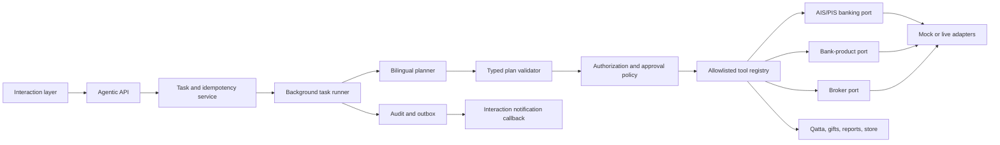

# Agentic Financial Service — Detailed Implementation Plan

Status: planning baseline  
Last reviewed: 2026-07-10  
Scope: the agentic service and the minimum interaction-layer changes required to integrate it safely

## 1. Purpose

Build an agentic financial service that receives a natural-language request from the existing interaction layer, converts it into a typed and validated action plan, applies deterministic authorization and financial rules, and then executes the request through replaceable provider adapters.

The implementation must support:

1. Transfers between a user's own accounts, including accounts at the same or different banks.
2. Transfers from one app user to another app user.
3. Adding and deleting beneficiaries using Saudi IBANs.
4. Investing through the Saudi market.
5. Qatta bill/payment splitting between multiple users.
6. Monthly financial reports.
7. Opening a savings account and funding it.
8. Gift transfers carrying UI-specific gift metadata.
9. A separate, read-only financial-analysis agent.
10. An in-app store with items that users can purchase.

The first runnable release will use stateful mock providers, require no bank credentials, and exercise every capability end to end. Live providers will use the same ports and workflows, but will fail closed until all required credentials, consents, certificates, partner capabilities, and regulatory prerequisites are configured.

## 2. Important Production Reality

Saudi Open Banking is not a generic API-key-only service. The code can be prepared before credentials arrive, but production activation requires more than inserting one secret.

As of July 2026:

- Saudi Open Banking covers Account Information Service (AIS) and Payment Initiation Service (PIS).
- Access is consent-based. A natural-language request or conversational confirmation is not bank authorization or Strong Customer Authentication (SCA).
- A production participant must be appropriately licensed/authorized by SAMA or integrate through a licensed provider.
- Provider/bank onboarding can require OAuth/OIDC FAPI configuration, PAR, mTLS certificates, signing keys, registered redirect URLs, scopes, provider-specific API profiles, conformance testing, and customer authorization journeys.
- PIS availability must be verified for the selected licensed provider and connected bank; it must not be inferred from the existence of an AIS integration.
- Securities trading is not an AIS/PIS operation. It requires a separate broker/capital-market integration.
- Opening a bank product such as a savings account is not an AIS/PIS operation. It requires a bank-product/KYC integration.
- Public AIS beneficiary APIs are generally read-only. In-app beneficiary management can be implemented now, while bank-side beneficiary write operations remain an optional provider capability.

This plan therefore uses five explicit capability boundaries:

| Capability | Owning integration |
| --- | --- |
| Account balances and transactions | AIS through `BankingPort` |
| Payment initiation and status | PIS through `BankingPort` |
| Savings-product opening | `BankProductPort` |
| Saudi-market quotes, portfolio, and orders | `BrokerPort` |
| Qatta, gift metadata, user directory, reports, and store | Internal application domains |

The mock implementation will expose all capabilities for development. A live capability endpoint will truthfully show which capabilities are enabled by the configured partners.

## 3. Current Repository Boundary

The existing interaction layer already defines the agentic wire contract.

### 3.1 Interaction to agentic

`POST /agentic/request`

```json
{
  "request_id": "uuid",
  "session_id": "uuid",
  "user_id": "user-1",
  "channel": "chat",
  "language": "en",
  "natural_language_request": "Transfer 250 SAR from my Al Rajhi account to my SNB account",
  "original_user_message": "Transfer 250 SAR from my Al Rajhi account to my SNB account",
  "confirmation": {
    "required": false,
    "received": true
  },
  "metadata": {
    "created_at": "2026-07-10T00:00:00Z",
    "source_provider": "openrouter",
    "conversation_context_summary": ""
  }
}
```

The synchronous response must arrive well inside the interaction client's 20-second timeout:

```json
{
  "request_id": "uuid",
  "task_id": "uuid",
  "status": "accepted",
  "user_safe_message": ""
}
```

The endpoint will persist and deduplicate the request, create a task, enqueue background work, and return. It must not wait for an LLM, bank, broker, or report operation.

### 3.2 Agentic to interaction

The agentic service publishes events to:

`POST /interaction/agentic-notification`

```json
{
  "task_id": "uuid",
  "request_id": "uuid",
  "session_id": "uuid",
  "event_type": "completed",
  "user_safe_summary": "Done. The transfer was completed.",
  "details": {},
  "created_at": "2026-07-10T00:00:01Z"
}
```

Allowed event types are `accepted`, `progress`, `input_needed`, `completed`, and `failed`.

### 3.3 Existing gaps that the implementation must handle

- The interaction layer always sends `confirmation.required=false` and `confirmation.received=true`. These values must not be treated as payment approval, investment approval, bank consent, or SCA.
- The callback endpoint currently performs no signature verification. A small, separately reviewed interaction-layer change must add constant-time shared-secret or HMAC verification before production.
- There is no explicit `reply_to_task_id` for answering an `input_needed` event. Initially, a new request may resume a prior task only when the same session has exactly one compatible pending task. An additive metadata field should be introduced later.
- Rejected agentic responses are currently rendered as accepted by the interaction orchestrator. Until fixed, valid wire requests should normally be acknowledged as `accepted`, then use an `input_needed` or `failed` event for safe business outcomes.
- The agentic request contains only `user_id`; the agentic service must resolve user identity, bank connections, consent scopes, account ownership, payees, and permissions on the server.

## 4. Goals and Non-Goals

### 4.1 Goals

- Preserve the existing natural-language boundary.
- Support English and Arabic requests.
- Ensure the LLM proposes actions but never directly executes provider calls.
- Use closed, typed command schemas and a deterministic validator/tool registry.
- Make every financial side effect idempotent, auditable, authorized, and recoverable.
- Run all ten capabilities without external credentials in mock mode.
- Provide configurable live adapters without inventing a universal Saudi bank API.
- Keep investment, product opening, and internal app workflows separate from AIS/PIS.
- Produce safe, localized, UI-ready result payloads.
- Degrade read-only analysis to deterministic facts if an LLM is unavailable.

### 4.2 Non-goals for the first implementation

- Claiming production readiness from one API key.
- Holding customer funds.
- Collecting bank passwords or OTPs.
- Bypassing bank authorization/SCA.
- Providing autonomous regulated investment advice.
- Allowing the LLM to call arbitrary tools, URLs, Python, SQL, or shell commands.
- Treating a submitted payment/order as settled.
- Supporting real-money calls in CI.
- Building the visual interaction UI; the service will return the metadata the UI needs.

## 5. Architecture



The core rule is:

> Natural language may create an action proposal. Only deterministic application services may validate, authorize, price, split, persist, and execute it.

## 6. Proposed Package Layout

```text
agentic/
  IMPLEMENTATION_PLAN.md
  README.md
  pyproject.toml
  requirements.txt
  .env.example
  run_server.py
  src/
    agentic_service/
      __init__.py
      bootstrap.py
      config.py
      api/
        app.py
        schemas.py
        dependencies.py
        errors.py
      domain/
        models.py
        commands.py
        events.py
        errors.py
        money.py
      orchestration/
        request_service.py
        planner.py
        context_builder.py
        plan_validator.py
        approval_policy.py
        tool_registry.py
        executor.py
        task_runner.py
        recovery.py
      agents/
        monthly_report.py
        financial_analysis.py
        narrative.py
      ports/
        banking.py
        bank_products.py
        broker.py
        identity.py
        notifications.py
        repositories.py
        secrets.py
        clock.py
      tools/
        transfers.py
        beneficiaries.py
        investments.py
        qatta.py
        reports.py
        savings.py
        gifts.py
        store.py
        analysis.py
      adapters/
        llm/
          heuristic.py
          openrouter.py
          openai.py
        banking/
          mock.py
          saudi_http.py
          profiles.py
          oauth.py
          signing.py
        bank_products/
          mock.py
          http.py
        broker/
          mock.py
          http.py
        identity/
          sqlite.py
        persistence/
          memory.py
          sqlite.py
          migrations/
        notifications/
          http.py
          capture.py
        secrets/
          environment.py
          vault.py
      security/
        authentication.py
        authorization.py
        idempotency.py
        audit.py
        redaction.py
        iban.py
  tests/
    fixtures/
    unit/
    contract/
    integration/
    e2e/
    security/
```

## 7. Core Technical Choices

- Python and FastAPI to match the existing project.
- Pydantic v2 for strict API and planner schemas.
- `Decimal` plus ISO currency codes for all money; never binary floats.
- Integer minor units for Qatta share allocation and store accounting.
- SQLite for the first persistent implementation, with repository ports that allow PostgreSQL later.
- `httpx` for async provider and callback calls.
- An in-process background runner in development/tests behind a `TaskRunner` port.
- A durable queue/worker implementation for production without changing orchestration logic.
- Provider-neutral LLM planning:
  - `heuristic` for zero-key deterministic demos and tests;
  - `openrouter` to align with the current application configuration;
  - optional `openai` structured-output adapter.
- No general-purpose agent framework in the first release. The typed planner/executor boundary is smaller, easier to audit, and sufficient for the workflows.

## 8. Domain Contracts

### 8.1 Planner output

The planner returns exactly one discriminated command or a structured request for missing information.

```text
ActionProposal =
  OwnAccountTransfer
  | UserTransfer
  | AddBeneficiary
  | DeleteBeneficiary
  | InvestmentOrder
  | CreateQatta
  | PayQattaShare
  | MonthlyReport
  | OpenSavingsAndFund
  | GiftTransfer
  | FinancialAnalysis
  | ListStoreItems
  | StorePurchase
  | NeedInput
```

Every command includes:

- `action_type`
- `schema_version`
- normalized typed fields
- the account/payee aliases mentioned by the user
- planner confidence
- source-language evidence spans
- missing fields, if any
- no credentials, raw tokens, or executable code

Unknown actions or extra fields fail validation. The system never falls back from an invalid mutation plan to guessed execution.

### 8.2 Important ports

```python
class Planner(Protocol):
    async def plan(self, request, context) -> ActionProposal: ...

class BankingPort(Protocol):
    capabilities: frozenset[BankCapability]
    async def list_accounts(self, principal, consent_ref): ...
    async def get_balances(self, principal, account_refs, consent_ref): ...
    async def get_transactions(self, principal, account_ref, period, consent_ref): ...
    async def initiate_payment(self, principal, instruction, authorization, idempotency_key): ...
    async def get_payment_status(self, external_id): ...

class BankProductPort(Protocol):
    async def list_savings_products(self, principal): ...
    async def open_savings_account(self, principal, product_code, onboarding_ref, idempotency_key): ...

class BrokerPort(Protocol):
    async def get_quote(self, symbol): ...
    async def get_portfolio(self, principal): ...
    async def place_order(self, principal, order, approval, idempotency_key): ...
    async def get_order_status(self, external_id): ...

class IdentityDirectoryPort(Protocol):
    async def resolve_user_payee(self, requester, user_alias): ...

class NotificationSink(Protocol):
    async def publish(self, event, idempotency_key): ...
```

Provider responses map to normalized internal statuses while preserving the raw provider reference and raw status separately.

## 9. Task and Side-Effect Lifecycle

### 9.1 Task states

```text
accepted
  -> planning
  -> input_needed
  -> awaiting_approval
  -> awaiting_bank_authorization
  -> running
  -> reconciling
  -> completed | partially_completed | failed | cancelled
```

The external interaction event is derived from this richer internal state:

| Internal state | Interaction event |
| --- | --- |
| accepted/planning/running/reconciling | accepted or progress |
| input_needed/awaiting approval/authorization | input_needed |
| completed/partially_completed | completed with truthful details |
| failed/cancelled | failed |

`partially_completed` is required for sagas such as “savings account opened, initial funding failed.”

### 9.2 Payment/order states

```text
draft
  -> consent_staged
  -> awaiting_user_authorization
  -> authorized
  -> submitted
  -> pending
  -> settled | rejected | failed | expired | cancelled
```

Rules:

- An authorization URL is not success.
- HTTP `200`/`201` from submission is not settlement unless the provider contract explicitly identifies a terminal settled status.
- An ambiguous timeout after submission triggers status reconciliation before any retry.
- Provider webhooks are signature-verified, deduplicated, and reconciled with polling.
- No balance, inventory, gift, Qatta share, or order is finalized twice.

## 10. Persistence Model

The initial SQLite schema will include:

### 10.1 Control plane

- `tasks`: task/request/session/user IDs, state, language, action type, safe result, timestamps, version.
- `request_idempotency`: unique request ID, canonical payload hash, task ID, original acknowledgement.
- `task_steps`: stable step index, command type, idempotency key, state, provider reference, retry metadata.
- `outbox_events`: event payload, destination, delivery state, attempts, next retry, dedupe key.
- `audit_events`: append-only actor, policy decision, masked inputs, action, result, provider ref, correlation IDs.
- `pending_inputs`: task, missing fields, expiry, session correlation, resolution state.

### 10.2 Banking/application state

- `bank_connections`: user, provider profile, consent references/scopes/status/expiry, encrypted token reference only.
- `account_aliases`: opaque local alias mapped to provider account reference; no credential data.
- `beneficiaries`: user-scoped local beneficiary, normalized IBAN, display name, verification state.
- `user_payees`: app user alias mapped to a verified opaque payee reference.
- `qattas` and `qatta_shares`: owner, total, currency, purpose, participants, exact shares, payment states.
- `gifts`: transfer reference, sender/recipient, sanitized message, theme, occasion, UI state.
- `store_items`: server-authoritative SKU, name, price, stock, active state, merchant payee.
- `inventory_reservations`: SKU, order, quantity, expiry, state.
- `orders`: buyer, priced total, payment reference/state, fulfillment state.
- `reports`: user, month, deterministic aggregates, narrative version, generated time.
- `analysis_snapshots`: minimized inputs/metrics and narrative metadata, subject to retention policy.

Tokens, private keys, and signing material must be stored in a secrets manager and referenced by identifier. They must not be placed in task JSON, audit JSON, planner context, or SQLite plaintext.

## 11. Natural-Language Planning

### 11.1 Processing sequence

1. Load the authenticated principal and task.
2. Build a minimal planning context containing permitted capabilities and user-facing aliases only.
3. Run the selected bilingual planner.
4. Parse the result into the closed Pydantic command union.
5. Validate required fields and normalize money, month, symbols, aliases, and IBAN.
6. Resolve aliases on the server.
7. Re-check ownership, consent scope, authorization, limits, provider capabilities, and current values.
8. If anything is missing, emit one clear `input_needed` question in the user's language.
9. For a mutation, construct an exact preview and acquire a short-lived approval/authorization state.
10. Execute only through the allowlisted tool registry.

### 11.2 Heuristic planner

The heuristic planner supports deterministic test/demo phrases in English and Arabic, including:

- action keywords and common Arabic equivalents;
- SAR amounts and currency normalization;
- Saudi IBAN extraction;
- account aliases, app-user aliases, Tadawul symbols, months, store SKUs, and Qatta participants;
- precedence rules so “send a gift” does not become a generic transfer;
- one specific missing-field response instead of guessing.

It is a fallback and test oracle, not the long-term free-form language solution.

### 11.3 LLM planner

- Use strict structured output matching the same command union.
- Use low temperature and a short task-specific system prompt.
- Provide aliases and capabilities, not credentials or unrestricted account history.
- Do not include mutation tools in the model API call.
- Reject unknown fields/actions and validate all model output again.
- Record model/provider/version and schema version for auditability.
- Apply timeouts and fail safely to `input_needed` or a user-safe failure.
- Build an evaluation set with at least two English and two Arabic formulations per feature, plus missing-field and adversarial cases.

### 11.4 Prompt-injection boundary

The interaction layer already screens user input, but the agentic layer must independently enforce:

- typed schemas;
- tool allowlists;
- server-side authorization after planning;
- no arbitrary URL, code, SQL, or shell execution;
- no secrets in model context;
- no model-generated price, balance, share total, fee, account ownership, or settlement truth.

## 12. Approval, Consent, and Authorization

Three concepts remain separate:

1. Conversational confirmation: the user said “yes” in the app.
2. Application approval: a short-lived, exact preview tied to actor, amount, payee, and action hash.
3. Bank/broker authorization: consent/SCA or partner authorization required by the external provider.

The existing interaction `confirmation` object is not sufficient for items 2 or 3.

### 12.1 Policy levels

| Action | Application approval | External authorization |
| --- | --- | --- |
| List store items | No | No |
| Monthly report | Analysis consent/valid AIS consent | AIS consent |
| Financial analysis | Explicit processing purpose/valid AIS consent | AIS consent |
| Add beneficiary locally | Confirm exact IBAN/display name | Only if bank sync is supported |
| Delete beneficiary | Explicit destructive confirmation | Only if bank sync is supported |
| Transfer/gift/store payment/Qatta share | Exact payment approval | PIS consent/SCA |
| Investment order | Quote/order preview and explicit approval | Broker authorization |
| Open/fund savings | Product/KYC confirmation and payment preview | Bank-product onboarding plus PIS SCA |

`APPROVAL_MODE=auto_mock` is permitted only when every mutation provider involved is a mock. Live startup must fail closed if this mode is selected.

## 13. Feature-by-Feature Workflow

### 13.1 Feature 1 — transfer between the user's accounts

Command: `OwnAccountTransfer`

Required fields:

- source account alias;
- destination account alias;
- positive amount and currency;
- optional payment purpose/reference.

Workflow:

1. Resolve both aliases under the authenticated user.
2. Verify source and destination ownership and that they are different accounts.
3. Load balances through AIS/current provider data.
4. Validate currency, available funds, configured limits, consent scope, and provider capability.
5. Show the exact preview, including known fees.
6. Acquire application approval and PIS authorization.
7. Initiate same-bank internal transfer or cross-bank payment according to the adapter capability.
8. Poll/reconcile until terminal status.
9. Return masked accounts, amount, status, and provider reference.

Failure cases include insufficient funds, stale/revoked consent, unsupported destination, limit breach, rejected SCA, ambiguous timeout, and non-settled provider status.

### 13.2 Feature 2 — transfer between app users

Command: `UserTransfer`

Workflow:

1. Resolve the recipient's app alias through `IdentityDirectoryPort`.
2. Verify that the payee is active and has a verified receiving account.
3. Return only an opaque/display payee to the sender; never expose the recipient's IBAN.
4. Follow the standard payment approval/PIS flow.
5. Record the app-level sender/recipient correlation without granting either user access to the other's financial data.

The directory must prevent users from changing another user's verified payee destination.

### 13.3 Feature 3 — add/delete beneficiaries by IBAN

Commands: `AddBeneficiary`, `DeleteBeneficiary`

Workflow:

1. Normalize whitespace and case.
2. Validate Saudi IBAN length, `SA` prefix, characters, and MOD-97 checksum.
3. Reject obviously self-conflicting or duplicate entries according to policy.
4. Store a user-scoped beneficiary idempotently.
5. Mask the IBAN in logs and events.
6. If the live adapter advertises `BENEFICIARY_WRITE`, optionally synchronize the change; otherwise keep the beneficiary as an in-app payee record.

Delete uses beneficiary ID or exact normalized IBAN, is idempotent, and requires explicit destructive confirmation.

### 13.4 Feature 4 — invest in the Saudi market

Command: `InvestmentOrder`

Required fields:

- Tadawul symbol/instrument;
- buy/sell side;
- quantity or investment amount;
- order type and optional limit price;
- funding account where applicable.

Workflow:

1. Resolve the symbol from authoritative broker/reference data.
2. Verify that `BrokerPort` is configured and the user is eligible/onboarded.
3. Request a time-limited quote and compute an exact preview.
4. Apply configured suitability/risk/product restrictions without letting the LLM invent advice.
5. Obtain explicit order approval tied to the quote/order hash.
6. Place the order with a stable idempotency key.
7. Reconcile accepted, partially filled, filled, rejected, cancelled, and expired states.
8. Update the internal view only from broker-authoritative status.

Live investment remains disabled unless an appropriate broker/capital-market partner is configured. The financial-analysis agent must never receive this mutation tool.

### 13.5 Feature 5 — Qatta

Commands: `CreateQatta`, `PayQattaShare`

Create workflow:

1. Resolve the organizer and participant aliases.
2. Validate total, currency, purpose, due date, participant membership, whether the organizer is included, and the requested split mode (`equal`, exact amounts, or percentages).
3. Convert the total and every proposed share to minor units; percentage/custom splits are recomputed and validated on the server.
4. For equal/percentage splits, allocate any remainder in a documented stable order so shares sum exactly to the total; reject custom amounts that do not sum exactly.
5. Persist the Qatta and participant obligations.
6. Notify participants with their own share and request ID.

Settlement workflow:

1. A participant may authorize only their own share.
2. Recompute outstanding value from server state.
3. Initiate one payment from that participant to the organizer/merchant.
4. Mark the share paid only after authoritative settlement.
5. Mark the Qatta complete only when every required share settles.

The organizer must never be able to debit all participants using one conversational request.

### 13.6 Feature 6 — monthly financial report

Command: `MonthlyReport`

Workflow:

1. Resolve the calendar month using the user's `Asia/Riyadh` timezone unless explicitly configured otherwise.
2. Load authorized AIS balances and transactions for the exact period.
3. Normalize duplicates, reversals, pending/posted state, and internal transfers.
4. Compute deterministic opening/closing balance, income, expenses, net cashflow, savings rate, category totals, recurring payments, and unusual changes.
5. Render a stable structured report.
6. Optionally generate a narrative from the already computed metrics.

The LLM must not calculate or alter totals. If narrative generation fails, return the deterministic report.

### 13.7 Feature 7 — create and fund a savings account

Command: `OpenSavingsAndFund`

Workflow:

1. Verify that `BankProductPort` is configured and expose available product choices.
2. Collect required product/KYC/onboarding information outside the LLM where necessary.
3. Confirm product terms and optional initial funding amount.
4. Open the account with a stable idempotency key.
5. Wait for authoritative account creation and obtain its opaque account reference.
6. If funding was requested, execute a separate PIS transfer step.
7. Report each saga step truthfully.

If account creation succeeds but funding fails, the result is `partially_completed`; the service must not pretend it rolled back an externally opened account.

### 13.8 Feature 8 — Gift

Command: `GiftTransfer`

Workflow:

1. Resolve recipient and execute the normal user/IBAN transfer workflow.
2. Sanitize gift message, occasion, and theme.
3. Persist immutable gift metadata linked to the payment reference.
4. Set `is_gift=true` and return a stable `gift_id` for UI rendering.
5. Put only a safe, size-limited reference into bank remittance information if allowed.
6. Change gift delivery state only from payment status.

Gift styling must not change payment authorization, risk, limits, or settlement rules.

### 13.9 Feature 9 — financial-analysis agent

Command: `FinancialAnalysis`

The analysis agent is a separate read-only component with no mutation tool registry.

Workflow:

1. Verify analysis purpose/consent and AIS access.
2. Load only the minimum required financial snapshot.
3. Compute deterministic metrics: liquidity runway, savings rate, debt/payment burden where data exists, category trends, recurring expenses, concentration, and cashflow volatility.
4. Remove/mask direct identifiers before any external LLM call.
5. Ask the narrative model to explain the computed facts, risks, uncertainty, and practical options.
6. Label the result as informational, not guaranteed or regulated investment advice.
7. Fall back to facts-only output if the model is unavailable.

The narrative must cite its internal metrics and must not claim access to data that was not supplied.

### 13.10 Feature 10 — in-app store

Commands: `ListStoreItems`, `StorePurchase`

Catalog workflow:

- Return active server-side items, price, currency, stock/availability, and UI metadata.
- Never trust a price supplied in natural language or by the client.

Purchase saga:

1. Resolve SKU and quantity.
2. Reprice from server-authoritative catalog data.
3. Atomically reserve inventory with an expiry.
4. Present the exact order/payment preview.
5. Initiate PIS or configured payment-gateway checkout.
6. Finalize the order only when payment settles.
7. Release inventory on rejection, failure, cancellation, or reservation expiry.
8. Fulfill at most once.

Concurrent purchases of the final item must result in no more than one successful fulfillment.

## 14. Saudi Provider Adapter Plan

### 14.1 Provider profile

Do not hard-code an invented universal endpoint. Define a provider profile containing:

- environment and capability flags;
- API/specification versions;
- API base URL and endpoint path map;
- issuer/discovery, PAR, authorization, token, JWKS, and optional CIBA URLs;
- client ID and registered redirect/deep-link URLs;
- scopes, audience, products, and bank/provider identifier;
- client authentication method (`mtls` or `private_key_jwt`);
- transport certificate/key/CA references;
- signing/encryption key references and key IDs;
- required signing algorithms and headers;
- webhook URL and verification credentials;
- timeout, rate-limit, retry, and provider status mappings;
- certificate/token expiry and rotation metadata.

### 14.2 AIS flow

1. Obtain an application token.
2. Stage account-access consent with exact permissions, purpose, and date range.
3. Build and sign the PAR request.
4. Redirect/deep-link the customer to the bank authorization journey.
5. Exchange the returned authorization code for a customer-bound token.
6. Read only the designated accounts/resources permitted by that consent.
7. Revoke/delete data according to consent withdrawal and retention rules.

### 14.3 PIS flow

1. Create the exact payment instruction and local idempotency record.
2. Stage the payment consent.
3. Direct the user through bank authentication/authorization.
4. Submit only the payment authorized by that consent; do not alter amount/payee afterward.
5. Store provider identifiers and normalized status.
6. Verify callbacks and poll/reconcile until terminal state.

The agent must never collect bank credentials or OTPs.

### 14.4 Error and retry policy

- Validate every provider response schema.
- Redact raw bodies before logging.
- Respect `429` and provider rate-limit headers.
- Retry safe reads with bounded exponential backoff and jitter.
- Retry mutations only with a provider-supported idempotency key and known-safe state.
- On timeout/5xx after possible submission, query status before retrying.
- Use circuit breaking/readiness degradation for prolonged provider outages.
- Map provider errors to safe domain errors; never expose a raw provider traceback/message to users.

## 15. API Surface

Required:

- `POST /agentic/request` — existing natural-language contract.
- `GET /health/live` — process liveness.
- `GET /health/ready` — persistence/runner/config readiness without secret values.
- `GET /agentic/capabilities` — truthful backend/provider capability matrix.
- `GET /agentic/tasks/{task_id}` — authenticated, user-scoped task status for diagnostics/UI polling.

OAuth/provider infrastructure:

- `POST /agentic/banking/connections/start`
- `GET /agentic/banking/connections/callback`
- `DELETE /agentic/banking/connections/{connection_id}`
- `POST /agentic/provider-webhooks/{provider}`

Optional direct read endpoints for the in-app UI:

- `GET /store/items`
- `GET /store/orders/{order_id}`
- `GET /qatta/{qatta_id}`

These do not replace the single natural-language action boundary. They support consent, provider callbacks, polling, and server-authoritative UI reads.

## 16. Authentication and Security Controls

### 16.1 Inbound authentication

- Development compatibility: constant-time validation of `X-Agentic-Webhook-Secret` when configured.
- Production: signed JWT and/or mTLS principal supplied by the trusted application gateway.
- Never trust body `user_id` by itself; it must match the authenticated principal or an explicitly authorized service actor.
- Rate-limit by principal, IP/client, and action class.

### 16.2 Authorization

Re-check at execution time:

- task ownership;
- source account ownership;
- recipient/payee scope;
- active consent and exact permissions;
- Qatta membership and share ownership;
- report/analysis subject;
- order ownership;
- provider and product capability;
- transaction limits and policy rules.

Cross-user access is denied even if an LLM proposes it.

### 16.3 Idempotency

Three levels are required:

1. Request level: unique `request_id` plus canonical payload hash.
2. Step level: `request_id:plan_version:step_index`.
3. Provider level: forward the stable key/correlation ID supported by the provider.

Behavior:

- Same request ID and same canonical hash returns the original task acknowledgement.
- Same request ID and different hash returns HTTP 409.
- Completed side effects are never re-run during task replay/recovery.
- Ambiguous provider state is reconciled before another mutation attempt.

### 16.4 Audit and privacy

Audit every allow, deny, approval, consent transition, tool call, provider submission, callback, reconciliation, and result.

Audit fields include actor, policy decision, correlation IDs, task/step, masked arguments, provider reference, before/after normalized state, and timestamps.

Never log:

- API keys, access/refresh tokens, private keys, JWT assertions, OTPs, or passwords;
- full IBANs/account/card identifiers;
- unrestricted transaction descriptions sent to an LLM;
- raw provider error bodies without redaction.

Saudi personal-data requirements and cross-border processing must be reviewed before sending financial data to any external LLM. Support data minimization, regional/local inference options, retention limits, consent-purpose tracking, deletion, and tokenization.

## 17. Configuration

Illustrative environment groups:

```text
# Runtime
AGENTIC_HOST=127.0.0.1
AGENTIC_PORT=8090
AGENTIC_ENV=development
AGENTIC_DATABASE_URL=sqlite:///agentic.db
AGENTIC_SHARED_SECRET=
INTERACTION_NOTIFICATION_URL=http://127.0.0.1:8088/interaction/agentic-notification
INTERACTION_NOTIFICATION_SECRET=

# Execution modes
AGENTIC_BANKING_BACKEND=mock
AGENTIC_BANK_PRODUCT_BACKEND=mock
AGENTIC_BROKER_BACKEND=mock
AGENTIC_APPROVAL_MODE=auto_mock

# Planner
AGENTIC_LLM_PROVIDER=heuristic
AGENTIC_LLM_MODEL=
AGENTIC_LLM_API_KEY=
AGENTIC_LLM_REQUIRED=false

# Saudi provider profile — required only for live mode
SAUDI_OB_PROFILE=
SAUDI_OB_BASE_URL=
SAUDI_OB_DISCOVERY_URL=
SAUDI_OB_PAR_URL=
SAUDI_OB_AUTHORIZATION_URL=
SAUDI_OB_TOKEN_URL=
SAUDI_OB_JWKS_URL=
SAUDI_OB_CLIENT_ID=
SAUDI_OB_CLIENT_AUTH_METHOD=
SAUDI_OB_SCOPES=
SAUDI_OB_AUDIENCE=
SAUDI_OB_REDIRECT_URI=
SAUDI_OB_MTLS_CERT_REF=
SAUDI_OB_MTLS_KEY_REF=
SAUDI_OB_SIGNING_KEY_REF=
SAUDI_OB_SIGNING_KID=

# Separate partner integrations
BANK_PRODUCT_BASE_URL=
BANK_PRODUCT_CREDENTIAL_REF=
BROKER_BASE_URL=
BROKER_CREDENTIAL_REF=
```

Live startup must list missing required settings precisely and exit. Mock startup must work with no external secret.

## 18. Implementation Phases

### Phase 0 — freeze contracts and capability truth

Deliverables:

- Check in request/response/event fixtures matching the interaction contract exactly.
- Finalize strict API settings and schemas.
- Define the typed command union and provider capability enum.
- Define mock/live backend modes and provider-profile schema.
- Record which port owns each requested feature.

Exit criteria:

- Every feature has an honest live-support classification.
- No universal Saudi endpoint or key-only claim is embedded in the design.
- Contract fixtures are approved.

### Phase 1 — service foundation and control plane

Deliverables:

- Package/runtime bootstrap and dependency injection.
- Health/capability/task endpoints.
- Fast request acknowledgement.
- Authentication, canonical hashing, request idempotency, task state machine.
- SQLite migrations/repositories.
- Append-only audit log.
- Notification outbox and capture sink.
- In-process runner and startup recovery skeleton.

Exit criteria:

- Invalid authentication is rejected safely.
- Identical duplicates return the same task; conflicting duplicates return 409.
- Restart preserves task state.
- Captured events exactly match the interaction schema.

### Phase 2 — stateful sandbox adapters

Deliverables:

- Money/IBAN/account/payment/transaction/consent/order models.
- Stateful mock bank with at least two users, two banks, and multiple accounts.
- Mock identity directory, bank-product provider, broker, catalog, and inventory.
- Deterministic clock/ID options for tests.
- Configurable success, rejection, insufficient funds, expired consent, and ambiguous timeout scenarios.

Exit criteria:

- All mock providers run with zero keys.
- Side effects are applied at most once.
- Adapter contract tests pass against mocks.

### Phase 3 — bilingual planner and deterministic policy

Deliverables:

- English/Arabic heuristic planner.
- Strict LLM planner adapters.
- Minimal planning context builder.
- Typed plan validator and allowlisted registry.
- Ownership/currency/limit/capability checks.
- Approval policy and pending-input correlation.

Exit criteria:

- Representative English and Arabic requests map to every command.
- Missing information produces one clear question.
- Unknown/malicious model output cannot execute.
- Mock and live approval modes are visibly and technically separate.

### Phase 4 — transfers, users, beneficiaries, and gifts

Deliverables:

- Own-account transfers.
- App-user payee resolution and transfer.
- Local beneficiary CRUD plus optional provider synchronization.
- Gift workflow and UI metadata.
- PIS consent/authorization/status abstractions.
- Initial Saudi HTTP adapter and mocked HTTP contract suite.

Exit criteria:

- Same-bank and cross-bank mock transfers settle correctly.
- Recipient IBAN is never exposed in P2P output.
- Saudi IBAN validation/masking is correct.
- Duplicate requests cannot double-debit.
- Pending SCA never appears completed.

### Phase 5 — Qatta, savings, and Store sagas

Deliverables:

- Exact Qatta ledger and participant payment workflow.
- Savings-product opening/funding saga.
- Store catalog, reservation, checkout, settlement, release, and fulfillment.

Exit criteria:

- Qatta shares always sum exactly.
- Each participant authorizes only their own payment.
- Savings partial success is represented truthfully.
- Concurrent final-item purchases fulfill at most one order.

### Phase 6 — investment, reports, and analysis

Deliverables:

- Broker quote/order/portfolio workflow.
- Calendar-month deterministic reporting.
- Read-only financial-analysis agent and narrative fallback.

Exit criteria:

- Mock investment changes cash/holdings at most once.
- Live investment is unavailable unless a broker is configured.
- Report totals match fixed transaction fixtures.
- Analysis has no mutation capability and degrades to facts-only.

### Phase 7 — recovery, security, integration, and operations

Deliverables:

- Outbox retries/deduplication.
- Startup recovery of nonterminal tasks.
- Ambiguous payment/order reconciliation.
- Per-account concurrency control/optimistic versions.
- Structured masked logs, metrics, and readiness.
- Interaction callback authentication change.
- Full test suites and cross-service demo.
- Setup, mock-data, live-onboarding, and operations documentation.

Exit criteria:

- Both services run together from a fresh setup.
- All ten features work through natural-language requests in mock mode.
- All tests pass.
- Live modes fail closed with precise missing-config/capability errors.

## 19. Test Strategy

### 19.1 Unit tests

- Strict API and command parsing.
- At least two English and two Arabic utterances per feature.
- Missing-field questions and ambiguous requests.
- Unknown action/field and prompt/tool-injection output rejection.
- Decimal money and currency validation.
- Saudi IBAN checksum, normalization, and masking.
- Qatta minor-unit rounding and remainder allocation.
- Monthly report aggregates, reversals, and internal-transfer handling.
- Approval/authorization policy.
- Cross-user and source-account ownership denial.
- Idempotency replay and conflict.
- Gift metadata sanitation.
- Inventory reservation/expiry.
- Analysis read-only tool registry.

### 19.2 Adapter contract tests

Run the same behavioral suite against the stateful mock and a mocked-HTTP live adapter:

- capabilities;
- consent scope/status mapping;
- OAuth/PAR/redirect and optional CIBA handling;
- mTLS/signing configuration and missing-certificate failures;
- exact correlation/idempotency propagation;
- success, pending, rejection, and partial states;
- malformed provider response;
- `429`, timeout, 4xx, and 5xx handling;
- ambiguous submission followed by status lookup;
- webhook signature, duplicate, and out-of-order event handling;
- redaction of raw requests/responses.

### 19.3 API contract tests

- Existing interaction request fixture accepted.
- Response fields and enums match exactly.
- Header authentication.
- Fast acknowledgement without waiting for execution.
- Duplicate replay and conflicting duplicate.
- Malformed payload and safe errors.
- Task ownership on status endpoint.
- Exact notification event ordering and schema.
- No secrets/full identifiers in events.

### 19.4 End-to-end mock tests

For every feature:

- one English success path;
- one Arabic success path;
- one missing-information or approval path;
- one domain/provider failure path.

Also test the real integration chain:

```text
interaction chat request
  -> HttpAgenticClient
  -> agentic request acknowledgement
  -> background planning/execution
  -> notification callback
  -> localized interaction response
```

### 19.5 Recovery and concurrency tests

- Crash after provider acceptance but before local completion.
- Restart with accepted/running/reconciling tasks.
- Notification outage and eventual outbox delivery.
- Duplicate provider callbacks.
- Revoked/expired consent and approval.
- Two payments racing against the same available balance.
- Two buyers racing for the last store item.
- Repeated Qatta share payment.
- Failed funding after successful savings-account opening.
- Partial/late broker fill.

### 19.6 Security tests

- Invalid/absent shared secret.
- Body `user_id` mismatch with authenticated principal.
- Access to another user's account, task, report, order, Qatta, or beneficiary.
- Prompt injection proposing a hidden/unregistered tool.
- Planner attempts to alter server price, Qatta total, payee, or approval hash.
- Logs/events contain no tokens, keys, full IBANs, or raw sensitive provider body.
- Analysis agent cannot obtain a mutation registry.

Live sandbox tests are opt-in and tagged. CI never performs real payments or orders.

## 20. Observability and Operations

### 20.1 Structured metrics

- request acceptance latency;
- planning latency/error rate by planner/model/schema;
- task counts/duration by state/action;
- input-needed/approval/authorization rates;
- provider latency/error/rate-limit counts;
- ambiguous submissions awaiting reconciliation;
- outbox backlog and delivery attempts;
- duplicate/idempotency conflicts;
- payment/order settlement time;
- report/analysis generation failures;
- inventory/Qatta concurrency conflicts.

Labels must avoid user IDs, IBANs, messages, and high-cardinality provider references.

### 20.2 Operational behavior

- Liveness does not call external providers.
- Readiness checks database, runner, configuration, and required live credential references.
- Capability response exposes support states, not secrets.
- Graceful shutdown stops new work and persists queued/nonterminal tasks.
- Production workers recover persisted tasks and outbox records.
- Certificate/token expiry generates proactive alerts.
- Provider status mapping/version changes are controlled through reviewed profiles and contract fixtures.

## 21. Delivery and Parallel Workstreams

After Phase 0 freezes interfaces, implementation can proceed in three coordinated workstreams:

1. Foundation: API, configuration, persistence, authentication, idempotency, audit, outbox, runner.
2. Domain: tools, workflows, mock state, Qatta/store/savings sagas, reporting, analysis.
3. Integrations: planners, Saudi provider security/profile, broker/product adapters, callbacks, adapter tests.

All workstreams merge on the typed domain/port contracts. End-to-end and recovery tests are completed jointly after Phase 2.

## 22. Risks and Mitigations

| Risk | Mitigation |
| --- | --- |
| “Just add an API key” conflicts with real Saudi onboarding | Provider profile abstraction, honest capability flags, lab/mock first, fail-fast live config, onboarding checklist |
| Open Banking does not cover trading/product opening/beneficiary writes | Separate broker/product ports and optional beneficiary-write capability; never fake support |
| Conversational confirmation mistaken for SCA | Separate application approval and bank/broker authorization states |
| Forged completion callback | HMAC/shared-secret validation, event dedupe, task correlation |
| LLM hallucinates a tool or critical value | Closed command union, strict schema, deterministic server validation and pricing |
| Duplicate/double payment | Request, step, and provider idempotency plus reconciliation after ambiguous errors |
| In-process runner loses work | Persist before enqueue, startup recovery, production durable queue |
| Mock/live drift or different banks | Shared adapter contract suite, provider profiles, lab fixtures, capability discovery |
| Qatta organizer debits participants | Obligation/request ledger; every payer authorizes their own share |
| Store oversells inventory | Atomic reservation and expiry; finalize only after payment settlement |
| Savings saga partially succeeds | Explicit step states and `partially_completed` result |
| Investment regulatory/suitability exposure | Separate compliant broker, explicit preview/approval, no promises/advice, capability disabled by default |
| Financial data leaks to LLM/logs | Minimized/redacted context, secrets references, regional/local option, privacy tests |
| Multiple pending `input_needed` tasks are ambiguous | Resume only a single compatible task; otherwise ask which; add `reply_to_task_id` later |
| Python/runtime dependency incompatibility | Pin versions verified in CI and document the supported Python version |
| Existing dirty interaction worktree | Keep main implementation isolated to `agentic/`; review any interaction callback changes separately |

## 23. Release Acceptance Criteria

The implementation is complete only when all of the following are true:

1. The existing `HttpAgenticClient` receives a backward-compatible acknowledgement well within 20 seconds.
2. Request and event JSON matches checked-in contract fixtures exactly.
3. Identical requests cannot create duplicate tasks or external side effects.
4. Conflicting reuse of a request ID returns 409.
5. Invalid authentication and cross-user access are denied.
6. Source account ownership and current consent scope are rechecked at execution.
7. Live payment/order actions never treat the current interaction confirmation flag as approval or SCA.
8. Pending provider authorization/submission is never presented as completed/settled.
9. All actions, denials, approvals, provider calls, and outcomes are auditable with masked data.
10. No secret, token, private key, full IBAN/account identifier, raw traceback, or raw provider error reaches logs or user events.
11. Each feature passes English, Arabic, missing-field, authorization, idempotency, and failure tests.
12. Qatta shares sum exactly and every participant pays only their own authorized share.
13. Savings creation and funding have independently truthful states.
14. Gift responses contain durable `gift_id`/`is_gift` UI metadata without weakening payment controls.
15. Monthly report totals match transaction fixtures exactly.
16. Financial analysis is read-only and facts remain available when narrative generation fails.
17. Store inventory/order/payment remains consistent on success, rejection, timeout, expiry, restart, and race.
18. Mock mode starts with no external key and supports all ten features end to end.
19. Live banking/product/broker modes fail closed and list missing settings/capabilities without exposing secret values.
20. Provider transport contract tests verify auth, consent, idempotency, status, error, and redaction behavior.
21. Restart, notification outage, duplicate callback, revoked consent, `429`, timeout, and ambiguous submission have asserted recovery outcomes.
22. Both services can be started together and a real natural-language interaction-to-agentic-to-notification demo passes.
23. Setup, mock users/data, example English/Arabic requests, live onboarding inputs, and operational commands are documented.
24. The complete unit, contract, integration, E2E, recovery, concurrency, and security test suite passes.

## 24. Production Onboarding Checklist

Code completion is not live-provider completion. Before enabling real users or money:

- Select a SAMA-authorized/licensed path or licensed provider.
- Verify contracted AIS and PIS capabilities for each supported bank.
- Obtain the exact provider specifications/profile versions.
- Register redirect/deep-link and webhook URLs.
- Configure OAuth/FAPI/PAR/CIBA behavior as applicable.
- Provision and rotate transport/signing/encryption certificates and keys.
- Complete sandbox and Open Banking Lab/conformance testing.
- Complete security, privacy, PDPL, retention, and cross-border-processing review.
- Add verified webhook/polling reconciliation.
- Select and contract a compliant bank-product partner for savings opening.
- Select and contract an appropriate Saudi-market broker/capital-market partner.
- Complete investment product, suitability, disclosure, and approval review.
- Run live sandbox smoke tests without real-value execution where possible.
- Use separately controlled production flags to enable each mutation capability.
- Conduct penetration, authorization, double-spend, incident-recovery, and operational-readiness testing.

## 25. Authoritative References

- [Saudi Open Banking program and Lab](https://www.openbanking.sa/index-en.html)
- [SAMA: Payment Initiation Service framework release](https://www.sama.gov.sa/en-us/mediacenter/news/pages/news-1036.aspx)
- [SAMA: commencement of Open Banking licensing, March 2026](https://www.sama.gov.sa/en-US/MediaCenter/News/pages/news-1135.aspx)
- [SAMA Rulebook: Payment Initiation and Account Information requirements](https://rulebook.sama.gov.sa/en/part-8-requirements-providing-payment-initiation-service-and-payment-account-information-service)
- [SAMA Rulebook Article 97: PIS duties and consent constraints](https://rulebook.sama.gov.sa/en/article-97-0)
- [SAMA Rulebook Article 99: AIS access and consent constraints](https://rulebook.sama.gov.sa/en/article-99-0)
- [OpenID Foundation: KSA Open Banking certified FAPI implementations](https://openid.net/certification/certified-fapi1-op-ksa-open-banking/)
- [SAMA Account Opening Rules](https://www.rulebook.sama.gov.sa/en/account-opening-rules)
- [CMA Capital Market Institutions Regulations](https://cma.org.sa/en/RulesRegulations/Regulations/Documents/Capital_Market_Institutions_Regulations_EN_2025V1.pdf)
- [Saudi Personal Data Protection Law](https://sdaia.gov.sa/en/SDAIA/about/Documents/Personal%20Data%20English%20V2-23April2023-%20Reviewed-.pdf)

## 26. First Implementation Step After Plan Approval

Begin with Phase 0 only: freeze the exact wire fixtures, typed command union, capability matrix, provider-profile schema, and mock/live security semantics. Do not start individual feature handlers until those shared contracts are reviewed, because idempotency, approval, provider boundaries, and task recovery depend on them.
