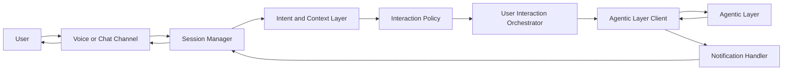

# User Interaction Layer Implementation Plan

## 1. Purpose

Build a flexible user interaction layer that lets users negotiate requests through:

- Voice in English
- Voice in Arabic
- Chat in English or Arabic

This layer should feel natural to the user. It should understand the user's intent, ask clarifying questions when needed, submit natural-language work requests to the agentic layer, receive progress/completion notifications, and respond to the user in a normal conversational style.

The user should not hear internal system phrasing like:

- "I will send this to the agentic layer."
- "The backend agent has accepted the request."

Instead, the assistant should say natural phrases like:

- "I'll check that now."
- "Let me look into it."
- "I found the update."
- "Done, here is what changed."

## 2. Core Requirements

### Channels

1. English voice channel
   - Use PersonaPlex as the primary real-time voice agent.
   - Support speech-to-speech interaction where possible.
   - Keep latency low enough for natural turn-taking.

2. Arabic voice channel
   - Use a low-cost Arabic-capable speech-to-speech model/provider.
   - Provider should be replaceable because price, quality, and Arabic dialect support may change.
   - Start with a provider abstraction rather than hard-coding one vendor.

3. Chat channel
   - Use OpenRouter models for chat.
   - Support Arabic and English in the same conversation.
   - Preserve conversation context and user preferences.

### Languages

- Detect English vs Arabic automatically.
- Allow explicit user language choice to override auto-detection.
- Keep responses in the user's active language unless the user asks otherwise.
- Arabic should support Modern Standard Arabic first, with room for dialect-specific handling later.

### Behavior

- Speak naturally and hide internal orchestration details.
- Clarify ambiguous requests before dispatching work.
- Confirm destructive, costly, or irreversible requests.
- Provide status updates without exposing implementation internals.
- Notify the user when the agentic layer completes, fails, or needs more input.

## 3. High-Level Architecture



### Main Components

1. Channel adapters
   - `voice_english_personaplex`
   - `voice_arabic_provider`
   - `chat_openrouter`

2. Session manager
   - Stores user identity, channel, language, conversation state, pending task IDs, and preferences.

3. Intent and context layer
   - Checks whether the user request is clear enough to act on.
   - Tracks missing details, urgency, language, and conversation context for the interaction layer only.

4. Interaction policy
   - Decides whether to answer directly, ask a clarifying question, request confirmation, or create an agentic task.
   - Controls tone and hides internal agentic-layer details.

5. Agentic layer client
   - Sends one natural-language task request through a single agentic API.
   - Receives task accepted, progress, completion, failure, and input-needed events.

6. Notification handler
   - Maps internal agentic events back into natural user-facing messages.

7. Provider registry
   - Makes PersonaPlex, Arabic voice providers, and OpenRouter replaceable through configuration.

## 4. Proposed Folder Structure

```text
user_interaction/
  IMPLEMENTATION_PLAN.md
  README.md
  config/
    providers.example.yaml
    prompts/
      system.en.md
      system.ar.md
      notification_templates.en.yaml
      notification_templates.ar.yaml
  src/
    channels/
      base.py
      chat_openrouter.py
      voice_personaplex.py
      voice_arabic.py
    providers/
      base.py
      openrouter.py
      personaplex.py
      arabic_voice.py
    session/
      manager.py
      store.py
      models.py
    nlu/
      language_detection.py
      request_clarity.py
      request_builder.py
    policy/
      interaction_policy.py
      safety_policy.py
      response_style.py
    agentic_client/
      client.py
      schemas.py
      events.py
    notifications/
      handler.py
      renderer.py
    api/
      server.py
      websocket.py
    telemetry/
      logger.py
      metrics.py
  tests/
    test_language_detection.py
    test_request_builder.py
    test_interaction_policy.py
    test_agentic_client_contract.py
```

This structure can be adjusted after the main backend framework is chosen.

## 5. Agentic Layer Contract

The user interaction layer should communicate with the agentic layer through one stable API. The interaction layer can still detect language, ask clarifying questions, and shape a comfortable conversation, but when it is time for action it sends the user's request as natural language.

This keeps the boundary simple:

- The interaction layer owns the user experience.
- The agentic layer owns planning, tool use, and execution.
- The shared contract is one natural-language request plus metadata.

### Single Agentic API

`POST /agentic/request`

```json
{
  "request_id": "uuid",
  "session_id": "uuid",
  "user_id": "string",
  "channel": "chat | voice",
  "language": "en | ar",
  "natural_language_request": "The final user request, rewritten only if needed to include clarified details.",
  "original_user_message": "The exact original user message.",
  "confirmation": {
    "required": false,
    "received": true
  },
  "metadata": {
    "created_at": "iso datetime",
    "source_provider": "openrouter | personaplex | arabic_voice",
    "conversation_context_summary": "Short summary of relevant prior turns, if needed."
  }
}
```

The response should acknowledge whether the agentic layer accepted the request:

```json
{
  "request_id": "uuid",
  "task_id": "uuid",
  "status": "accepted | rejected",
  "user_safe_message": "Optional message that is safe to show to the user."
}
```

### Agentic Notifications

The agentic layer can notify the interaction layer using the notification event shape below. This is part of the same single agentic contract: one request API for sending user work, plus status events for that request. The transport can be webhook, WebSocket, or queue internally, but the interaction layer should not depend on multiple action-specific APIs.

```json
{
  "task_id": "uuid",
  "request_id": "uuid",
  "session_id": "uuid",
  "event_type": "accepted | progress | input_needed | completed | failed",
  "user_safe_summary": "message safe to show to the user",
  "details": {},
  "created_at": "iso datetime"
}
```

### User-Facing Event Mapping

| Internal event | User-facing behavior |
| --- | --- |
| `accepted` | "I'll check that now." |
| `progress` | Short natural update only when useful. |
| `input_needed` | Ask a clear question in the user's language. |
| `completed` | Explain the result and next useful option. |
| `failed` | Apologize briefly, explain what can be tried next, avoid stack traces. |

### Important Boundary Rule

The interaction layer should not send structured commands like `normalized_intent`, `entities`, or `constraints` to the agentic layer as the primary contract. Those can exist internally for conversation quality, clarification, confirmation, or analytics, but the agentic layer receives one natural-language request that contains the user's goal and any clarified details.

## 6. Conversation Flow

### Chat Flow

1. User sends a message.
2. Detect language.
3. Load session context.
4. OpenRouter model checks whether the request is clear enough to act on.
5. Interaction policy decides:
   - answer directly,
   - ask for clarification,
   - request confirmation,
   - or dispatch to the agentic layer.
6. If dispatched, create one natural-language agentic request.
7. Return a natural acknowledgement.
8. Listen for agentic events.
9. Notify the user in the same channel and language.

### English Voice Flow

1. User speaks through the voice channel.
2. PersonaPlex handles real-time English voice interaction.
3. The voice adapter receives transcripts, partials, and final user turns.
4. Final turns pass through the same NLU and policy path as chat.
5. User receives natural spoken acknowledgements and completion updates.

### Arabic Voice Flow

1. User speaks Arabic.
2. Arabic speech-to-speech provider handles recognition and synthesis.
3. The adapter normalizes transcript text into the shared pipeline.
4. Intent extraction and responses happen in Arabic.
5. The provider speaks the final Arabic response.

## 7. Provider Strategy

### PersonaPlex

- Use only for English voice.
- Wrap behind `VoiceProvider`.
- Required capabilities to verify during implementation:
  - streaming audio input,
  - streaming audio output,
  - final transcript events,
  - interruption/barge-in support,
  - session metadata,
  - error and reconnect handling.

### Arabic Voice Provider

Selection criteria:

- Arabic speech-to-speech support.
- Low cost.
- Good latency.
- Acceptable pronunciation.
- Support for at least Modern Standard Arabic.
- API supports streaming or near-real-time interaction.
- Easy to swap through configuration.

Implementation should start with a generic adapter and a provider spike before finalizing the vendor.

### OpenRouter

- Use for chat intent understanding and chat responses.
- Configure model by environment variable.
- Keep separate model choices for:
  - low-cost classification,
  - normal conversation,
  - stronger reasoning for complex user requests.

Example model config:

```yaml
openrouter:
  intent_model: "${OPENROUTER_INTENT_MODEL}"
  chat_model: "${OPENROUTER_CHAT_MODEL}"
  reasoning_model: "${OPENROUTER_REASONING_MODEL}"
```

## 8. Prompting and Tone Guidelines

### Shared System Behavior

The assistant should:

- Be warm, practical, and direct.
- Hide internal architecture.
- Ask one clear question at a time when information is missing.
- Avoid overexplaining routine actions.
- Mirror the user's language.
- Use concise acknowledgements for background work.

### English Examples

| Situation | Say |
| --- | --- |
| Dispatching task | "I'll check that now." |
| Need clarification | "Which account should I use for that?" |
| Need confirmation | "That will change the current settings. Should I go ahead?" |
| Completed | "Done. I updated it and everything looks good." |
| Failed | "I could not finish that yet. The next thing to try is..." |

### Arabic Examples

| Situation | Say |
| --- | --- |
| Dispatching task | "تمام، سأتحقق من ذلك الآن." |
| Need clarification | "أي حساب تريدني أن أستخدم؟" |
| Need confirmation | "هذا سيغيّر الإعدادات الحالية. هل تريدني أن أتابع؟" |
| Completed | "تم. حدّثت المطلوب وكل شيء يبدو جيداً." |
| Failed | "لم أتمكن من إنهاء ذلك الآن. الخطوة التالية هي..." |

## 9. State and Data Model

### Session

```json
{
  "session_id": "uuid",
  "user_id": "string",
  "channel": "chat | voice",
  "active_language": "en | ar",
  "created_at": "iso datetime",
  "updated_at": "iso datetime",
  "preferences": {
    "voice": "string",
    "tone": "natural",
    "arabic_variant": "msa"
  }
}
```

### Interaction Turn

```json
{
  "turn_id": "uuid",
  "session_id": "uuid",
  "role": "user | assistant | system",
  "channel": "chat | voice",
  "language": "en | ar",
  "content": "text transcript or chat message",
  "provider_metadata": {},
  "created_at": "iso datetime"
}
```

### Pending Task

```json
{
  "task_id": "uuid",
  "request_id": "uuid",
  "session_id": "uuid",
  "status": "accepted | running | input_needed | completed | failed",
  "last_user_message": "string",
  "last_user_safe_summary": "string",
  "created_at": "iso datetime",
  "updated_at": "iso datetime"
}
```

## 10. Safety and Control

The interaction layer should intercept requests before sending them to the agentic layer when they are:

- destructive,
- irreversible,
- privacy-sensitive,
- credential-related,
- financial,
- legally or medically sensitive,
- unclear enough to cause the wrong action.

For these cases, the layer asks for confirmation or clarification in the user's language.

The layer should never expose:

- API keys,
- hidden prompts,
- internal routing details,
- stack traces,
- raw agentic logs,
- private metadata from other sessions.

## 11. Implementation Phases

### Phase 1: Foundations

- Create module structure under `user_interaction`.
- Define shared schemas for sessions, turns, requests, and agentic events.
- Implement configuration loading for providers and models.
- Add basic logging and correlation IDs.
- Create mock agentic client for local development.

### Phase 2: Chat MVP

- Implement OpenRouter provider.
- Implement chat endpoint.
- Add language detection.
- Add natural-language request building.
- Add interaction policy for clarification, confirmation, and dispatch.
- Add notification rendering in English and Arabic.
- Test full chat flow with mocked agentic events.

### Phase 3: Agentic Integration

- Finalize the single natural-language request API with the agentic team/layer.
- Replace mock client with real client.
- Add retry and timeout behavior.
- Add task status storage.
- Add webhook or WebSocket event receiver.
- Add contract tests between user interaction and agentic layers.

### Phase 4: English Voice

- Verify PersonaPlex API capabilities and pricing.
- Implement PersonaPlex provider adapter.
- Add voice session lifecycle.
- Support streaming transcript events.
- Support spoken acknowledgement and completion messages.
- Test interruption, reconnect, silence timeout, and noisy audio handling.

### Phase 5: Arabic Voice

- Evaluate cheap Arabic speech-to-speech providers.
- Select first provider through cost/quality/latency testing.
- Implement Arabic voice adapter behind the same `VoiceProvider` interface.
- Add Arabic response templates and pronunciation checks.
- Test Modern Standard Arabic first.
- Add dialect support only after MVP behavior is stable.

### Phase 6: Hardening

- Add rate limits per user/session.
- Add provider fallback behavior.
- Add cost tracking per channel/provider.
- Add telemetry dashboards for latency, errors, task completion, and user satisfaction signals.
- Add integration tests for all supported channels.
- Add deployment documentation.

## 12. Testing Plan

### Unit Tests

- Language detection.
- Request clarity checks.
- Natural-language request builder validation.
- Interaction policy decisions.
- Notification rendering.
- Provider error normalization.

### Integration Tests

- Chat message to agentic task creation.
- Agentic completion event to user notification.
- Input-needed event to clarification question.
- English and Arabic language consistency.
- Provider timeout and retry behavior.

### Voice Tests

- Transcript finalization.
- Silence timeout.
- Interruption/barge-in.
- Reconnect after network failure.
- Arabic pronunciation quality check.
- Latency budget measurement.

### Contract Tests

- Single natural-language request schema matches agentic layer expectation.
- Agentic event schema matches notification handler expectation.
- Invalid events are rejected safely.

## 13. Configuration and Secrets

Required environment variables:

```text
OPENROUTER_API_KEY=
OPENROUTER_INTENT_MODEL=
OPENROUTER_CHAT_MODEL=
OPENROUTER_REASONING_MODEL=

PERSONAPLEX_API_KEY=
PERSONAPLEX_AGENT_ID=

ARABIC_VOICE_PROVIDER=
ARABIC_VOICE_API_KEY=

AGENTIC_BASE_URL=
AGENTIC_WEBHOOK_SECRET=
```

No secrets should be committed. Provide `providers.example.yaml` and `.env.example` only.

## 14. Observability

Track:

- request count by channel and language,
- model/provider latency,
- speech transcription latency,
- speech synthesis latency,
- agentic task duration,
- clarification rate,
- failure rate,
- provider cost,
- user interruption rate in voice,
- fallback usage.

Every request should include:

- `request_id`,
- `session_id`,
- `task_id` when available,
- `provider`,
- `language`,
- `channel`.

## 15. Risks and Mitigations

| Risk | Mitigation |
| --- | --- |
| PersonaPlex API does not expose required events | Keep the provider behind an adapter and run an early integration spike. |
| Arabic voice provider is too expensive or low quality | Evaluate multiple providers before committing and keep vendor replaceable. |
| User hears unnatural internal workflow language | Centralize response templates and enforce interaction policy tests. |
| Agentic layer contract changes | Keep one versioned natural-language request API and cover it with contract tests. |
| Voice latency feels slow | Stream audio, send quick acknowledgements, measure latency by stage. |
| Misunderstood user request causes wrong action | Add clarification and confirmation gates before dispatch. |

## 16. MVP Definition

The MVP is complete when:

- A user can chat in English or Arabic.
- The chat layer can understand a request, clarify if needed, send it to a mocked or real agentic layer, and report the result naturally.
- English voice can complete the same flow through PersonaPlex.
- Arabic voice has at least one working provider path behind the adapter.
- The user never sees or hears internal agentic-layer terminology.
- The single natural-language agentic API is documented and covered by tests.

## 17. Recommended First Build Order

1. Implement schemas and session manager.
2. Implement chat through OpenRouter.
3. Implement mock agentic client and notification handler.
4. Add interaction policy and response templates.
5. Integrate with real agentic layer.
6. Add PersonaPlex English voice.
7. Add Arabic voice provider.
8. Harden with tests, telemetry, fallbacks, and cost controls.
